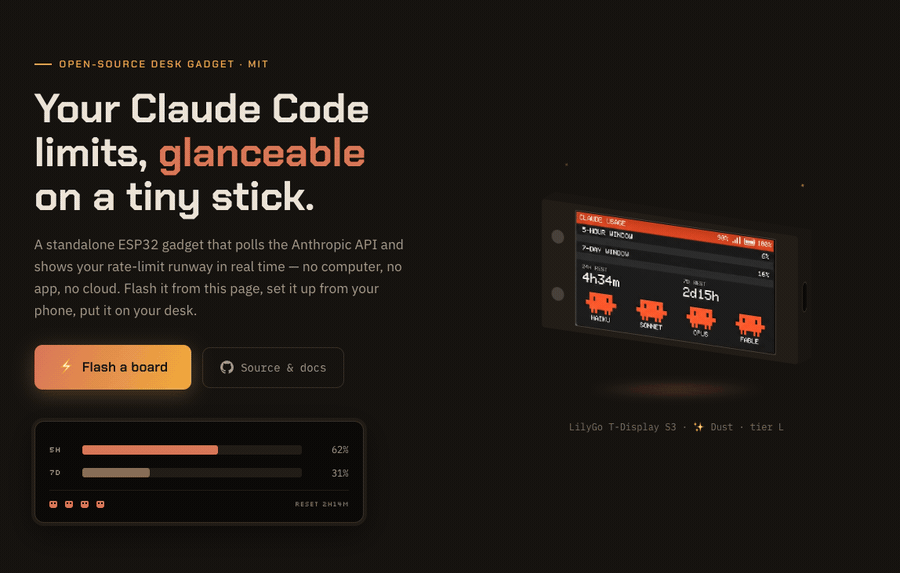

<div align="center">

# Claude Usage Stick

**Your [Claude Code](https://docs.anthropic.com/en/docs/claude-code) rate limits, glanceable on a tiny ESP32 stick.**

[](https://oauramos.github.io/claude-usage-stick/)
[](https://github.com/oauramos/claude-usage-stick/wiki)
[](https://github.com/oauramos/claude-usage-stick/wiki/Supported-Boards)
[](LICENSE)

<a href="https://oauramos.github.io/claude-usage-stick/"></a>

## [⚡ Flash your ESP32 — right from your browser](https://oauramos.github.io/claude-usage-stick/)

*No toolchain, no drivers, no clone — just Chrome, Edge or Firefox and a USB-C cable.*

*5-hour & 7-day usage windows · reset countdowns · model health mascots · PIN-encrypted token · web control panel · screen carousel with 7-day chart, Anthropic news & clock (✨ Dust, v3)*

</div>

---

A standalone desk gadget that polls the Anthropic API and shows your Claude Code rate-limit usage in real time — no computer, no app, no cloud. Flash it, connect it to WiFi from your phone, and it just sits there telling you how much runway you have left.

## What it does

**On every board**

- **Live usage bars** — the 5-hour and 7-day rate-limit windows, read straight from the `anthropic-ratelimit-unified-*` headers, refreshed every 30 s – 5 min
- **Reset countdowns** — exactly how long until each window frees up
- **Model health mascots** — Haiku / Sonnet / Opus / Fable from status.claude.com as blinking Clawds (Mango v2+)
- **PIN-encrypted token** — AES-256-GCM on the device's own flash; the PIN is never stored, and 10 wrong tries wipes it
- **Captive-portal setup** — no hardcoded credentials, no serial console; configure it from your phone

**✨ New in Dust (v3 — [T-Display S3](https://github.com/oauramos/claude-usage-stick/wiki/LilyGo-T-Display-S3) and [M5StickC Plus](https://github.com/oauramos/claude-usage-stick/wiki/M5StickC-Plus))**

- **[Web control panel](https://github.com/oauramos/claude-usage-stick/wiki/Web-Panel)** — the stick serves its own settings page at `http://claude-usage-stick.local`: every setting, WiFi changes and factory reset from any browser on your LAN. Logging in with the PIN also unlocks the screen
- **Token rotation without a reset** — paste a fresh `claude setup-token`, confirmed with your PIN and verified live against the API; the stored token is write-only
- **Screen modes** — static, carousel (dwell 5–30 s) or desk clock; Button A steps through every screen
- **7-day usage chart** — one sample every 30 minutes, persisted on-device; time spent off shows as honest gaps
- **Anthropic news** — the latest headlines, streamed from the official feed every 6 h
- **Clock & timezone** — local time on the clock screen and on the chart's day markers
- **WiFi recovery** — an unreachable network opens a reconfigure portal (token, PIN and settings survive) instead of a reboot loop
- **Quality of life** — brightness and screen flip persist across reboots, the header alternates device name ↔ address, mDNS, and the board's full 16 MB flash + 8 MB PSRAM are finally in use

## Get one running

### ⚡ Flash it from your browser

**[oauramos.github.io/claude-usage-stick](https://oauramos.github.io/claude-usage-stick/)** — pick your board, plug it in over USB-C, hit Flash. Nothing to install; any desktop browser with Web Serial — Chrome, Edge, Opera, or Firefox 151+.

### Or build from source

```bash
git clone https://github.com/oauramos/claude-usage-stick.git
cd claude-usage-stick

pio run -e <env> -t upload      # firmware
```

Needs the [PlatformIO CLI](https://platformio.org/install/cli). Board envs are listed in [Supported boards](https://github.com/oauramos/claude-usage-stick/wiki/Supported-Boards).

Either way, the device then opens its own WiFi network so you can configure it from your phone — see [Setup and daily use](https://github.com/oauramos/claude-usage-stick/wiki/Setup-and-Daily-Use).

## Documentation

Everything lives in the **[wiki](https://github.com/oauramos/claude-usage-stick/wiki)**:

| | |
| --- | --- |
| [Features](https://github.com/oauramos/claude-usage-stick/wiki/Features) | What the device shows |
| [The UI](https://github.com/oauramos/claude-usage-stick/wiki/The-UI) | Firmware versions and display tiers |
| [Web panel](https://github.com/oauramos/claude-usage-stick/wiki/Web-Panel) | The in-browser control panel (✨ Dust boards) |
| [Supported boards](https://github.com/oauramos/claude-usage-stick/wiki/Supported-Boards) | The lineup, with a guide for each board |
| [Flashing](https://github.com/oauramos/claude-usage-stick/wiki/Flashing) | Web flasher and building from source |
| [Setup and daily use](https://github.com/oauramos/claude-usage-stick/wiki/Setup-and-Daily-Use) | Captive-portal setup, PIN, controls |
| [How it works](https://github.com/oauramos/claude-usage-stick/wiki/How-It-Works) | The API request and the headers it reads |
| [Security](https://github.com/oauramos/claude-usage-stick/wiki/Security) | How your OAuth token is encrypted on-device |
| [Troubleshooting](https://github.com/oauramos/claude-usage-stick/wiki/Troubleshooting) | When something doesn't work |

Wiki pages are written in [`wiki/`](wiki/) and published automatically, so docs get reviewed in PRs like any other change.

## Hardware Adaptation Notes — Mini ESP32-S3 3.5" (AXS15231B)

The `mini-s3-35` env ports the firmware to the Guition/stemedu JC3248W535C_I "Mini ESP32-S3 3.5"" — an ESP32-S3 board with a 3.5" 480×320 IPS capacitive-touch panel driven over **QSPI** by an **AXS15231B** controller (which also handles touch, over I²C). The pin map and touch driver come from [benevid/claude-usage-stick-SVGL](https://github.com/benevid/claude-usage-stick-SVGL), which targets this exact module; the display driver bug that took most of the bring-up time to track down did not come from that reference, though — see below. This port is hardware-validated: flashed and confirmed working on a real unit, not just derived from reference docs. Full detail lives on [the wiki page](https://github.com/oauramos/claude-usage-stick/wiki/Mini-ESP32-S3-35); the summary:

- **No LVGL.** The reference project uses LVGL; this firmware draws with TFT_eSPI calls (`ui.cpp` / `screens.cpp`), so the port keeps that stack. There's no `lv_conf.h` anywhere in this codebase.
- **TFT_eSPI as a sprite only.** TFT_eSPI has no AXS15231B driver. As with the T-Display S3 AMOLED env, it's listed as a dependency purely to provide `TFT_eSprite` — an in-memory canvas the UI draws into — with no `USER_SETUP_LOADED` and no `TFT_*` pin defines. The actual pixel push to the panel goes through `Arduino_GFX` in `hal.cpp`.
- **The real bug: a library version regression, not a hardware quirk.** The panel is native 320×480 portrait; the firmware runs it landscape (480×320) by keeping the controller at rotation 0 and rotating pixels in software during `halFlush()` — that part of the plan held up. What didn't: `moononournation/GFX Library for Arduino` 1.6.1 and later have a real, since-reported regression in the AXS15231B QSPI init sequence for this exact panel ([issue #803](https://github.com/moononournation/Arduino_GFX/issues/803)), which on real hardware showed as static/noise across most of the screen. The fix is pinning to 1.6.0 — vendored locally at `lib/GFX_Library_for_Arduino/` rather than pulled via `lib_deps`, since PlatformIO has no way to pin one dependency's dependency to an exact old version otherwise. See the comment block above `[env:mini-s3-35]` in `platformio.ini` for the full chain of findings (this one plus two build-environment issues below it).
- **UI code needed small edits, not just a HAL.** The plan for this port originally assumed `ui.cpp` could stay untouched by riding an existing "MANGO_UI" feature gate — that assumption didn't hold up against the actual code: the CrowPanel Advance 3.5" (the closest existing board, same 480×320 resolution and touch-zone controls) doesn't use `MANGO_UI` at all. Instead it has its own small `#elif defined(BOARD_CROWPANEL_ADV_35)` branches for coordinate scaling and touch-appropriate hint text. `mini-s3-35` was wired into those same branches (see `ui.cpp`) rather than into `MANGO_UI`, which would have pulled in an unrelated dashboard theme.
- **Touch driver ported from Portuguese.** `src/touch_axs15231b.h` is a straight port of the benevid reference's `AXS15231B_Touch` class, with its Portuguese comments translated to English. This was the entire "translation" scope for this port — the upstream project itself is already in English.
- **Known limitation:** touch reports a single point, so the two-finger factory-reset gesture other boards support isn't available here (same as CrowPanel). Re-flash to wipe NVS.
- **Battery ADC identified, not yet wired up.** GPIO 5, confirmed from Guition's own vendor demo firmware for this board (not just inferred) — `halBatPercent()` stays stubbed to `-1` until the voltage-divider ratio is validated against real battery hardware.
- **Bring-up first.** A dedicated `mini-s3-35-bringup` env (I²C scan, QSPI fill tests, raw touch coordinates) exists so a wrong pin fails loudly before it becomes a blank screen in the full firmware — see `bringup/mini-s3-35/main.cpp`.

## Contributing

PRs welcome — especially new board support and photos of real builds. See [Project structure](https://github.com/oauramos/claude-usage-stick/wiki/Project-Structure) for the repo layout and what adding a board involves.

## License

[MIT](LICENSE)
